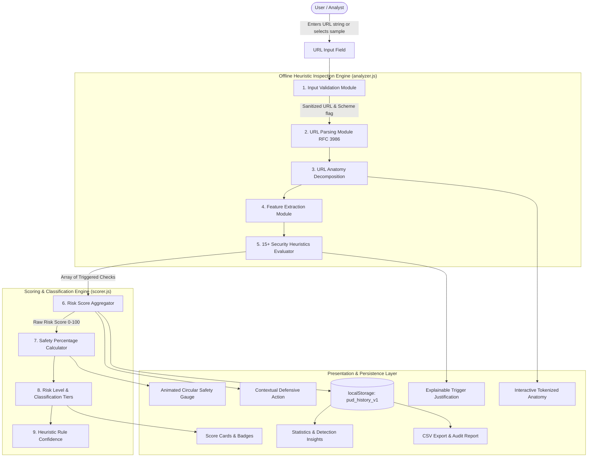

# System Architecture Specification

## Phishing URL Detector (PhishGuard)
**First-Year CSIT Semester Integrated Project (PBL) — Progress Review-II**

---

## 1. Architectural Overview & Privacy Model

The **Phishing URL Detector** is an explainable, 100% client-side web application built using native Web Standards (HTML5, CSS3, and ECMAScript 2020+ ES Modules). 

### Zero-Fetch Privacy Guarantee
Unlike traditional threat scanners that connect to or render the target website, this system performs **zero-fetch, offline lexical string heuristics**:
- **No HTTP/HTTPS requests** are sent to the target destination.
- **No DNS queries** or IP resolutions are performed.
- **No WHOIS lookups** or third-party cloud threat API calls are made.
- **No user credentials** or telemetry data leave the client browser.

This design completely eliminates the risk of drive-by malware downloads, browser exploits, or alerting the phishing attacker through server access logs.

---

## 2. End-to-End Data Pipeline Architecture



---

## 3. Detailed Data Flow Description

1. **User Input**: The user inputs a candidate URL string or selects one of the controlled demo presets.
2. **Input Validation (`validateUrlInput`)**:
   - Trims whitespace.
   - Enforces the RFC 7230 URI length constraint ($\le 2048$ characters).
   - Rejects empty, whitespace-only, or malformed strings.
   - If protocol scheme is missing (e.g. `example.test`), defaults to `http://` for parsing while setting `schemeAssumed: true` to notify the user.
3. **URL Parsing (`parseUrlAnatomy`)**:
   - Parses the normalized string conforming to RFC 3986.
   - Decomposes into: `protocol`, `host`, `subdomain`, `registeredDomain`, `port`, `explicitPort`, `pathname`, `search`, `hash`, and length metrics.
   - Distinguishes between IPv4/IPv6 literals and registered domain names.
4. **Feature Extraction**:
   - Quantifies dot counts, subdomain depth, hyphen frequencies, digit counts, digit-to-letter ratios, and percent-encoding tokens.
   - Identifies whether the host matches known URL shortening registries or high-abuse TLDs.
5. **15+ Rule Checks (`runSecurityChecks`)**:
   - Evaluates 15 discrete heuristic checks.
   - Each check yields: `{ id, name, triggered, points, severity, explanation, detail }`.
6. **Risk Scoring & Safety Percentage (`calculateRiskAndSafety`)**:
   - Calculates the bounded Risk Score:
     $$\text{Risk Score} = \min\left(100, \sum_{\text{rule} \in \text{Triggered}} \text{Weight}(\text{rule})\right)$$
   - Calculates the Safety Percentage:
     $$\text{Safety Percentage} = \max\left(0, \min\left(100, 100 - \text{Risk Score}\right)\right)$$
7. **Risk Classification**:
   - **LOW RISK**: $70\% - 100\%$ Safe $\implies$ Green
   - **MEDIUM RISK**: $40\% - 69\%$ Safe $\implies$ Yellow / Amber
   - **HIGH RISK**: $0\% - 39\%$ Safe $\implies$ Red
   - **SAFE**: Risk Score $0 - 29$
   - **SUSPICIOUS**: Risk Score $30 - 59$
   - **PHISHING**: Risk Score $60 - 100$
8. **Rule Confidence**:
   - Transparent heuristic formula evaluating rule consensus and feature density (strictly non-AI).
9. **UI & Persistence**:
   - Updates circular gauge and breakdown.
   - Logs scan into `localStorage` (`pud_history_v1`).
   - Updates Detection Insights frequency ranking.

---

## 4. The 15 Security Heuristic Rules Specification

| # | Rule Identifier | Default Weight | Severity | Heuristic Purpose & Evaluation Logic |
|---|---|---|---|---|
| 1 | `RULE_NO_HTTPS` | 15 pts | MEDIUM | Evaluates if scheme is plain `http:` instead of encrypted `https:`. Plaintext connections are vulnerable to interception. |
| 2 | `RULE_IP_HOST` | 25 pts | HIGH | Checks if host is an IPv4 or IPv6 literal (`^[0-9.]+$`). Attackers use raw IPs to bypass domain reputation blocklists. |
| 3 | `RULE_AT_SYMBOL` | 20 pts | HIGH | Evaluates presence of `@` symbol. Per RFC 3986, characters before `@` are userinfo; browsers route to the host *after* `@`. |
| 4 | `RULE_EXCESSIVE_LENGTH` | 10 pts | LOW | Checks if total URL length exceeds 75 characters. Attackers inflate URLs to obscure destination hostnames on mobile devices. |
| 5 | `RULE_EXCESSIVE_SUBDOMAINS` | 12 pts | MEDIUM | Evaluates whether domain has $\ge 3$ subdomains or $\ge 4$ dots. Attackers nest subdomains to disguise fake hosts. |
| 6 | `RULE_EXCESSIVE_HYPHENS` | 10 pts | LOW | Flags $\ge 2$ hyphens in host or $\ge 4$ in path. Commonly observed in typosquatting and fake domain generation. |
| 7 | `RULE_SUSPICIOUS_KEYWORDS` | 14 pts | MEDIUM | Scans for urgency/credential tokens (`login`, `verify`, `account`, `banking`, `secure`, `update`, `signin`, `wallet`, etc.). |
| 8 | `RULE_UNUSUAL_PORT` | 15 pts | MEDIUM | Flags explicit non-standard ports (e.g. `:8080`, `:8888`, `:81`) outside standard web ports 80/443. |
| 9 | `RULE_PUNYCODE_HOST` | 16 pts | HIGH | Detects `xn--` prefix or multi-byte unicode characters used in IDN homograph spoofing attacks. |
| 10 | `RULE_URL_SHORTENER` | 12 pts | MEDIUM | Matches host against known shortening services (`bit.ly`, `tinyurl.com`, `t.co`, etc.) which conceal destination targets. |
| 11 | `RULE_SUSPICIOUS_TLD` | 15 pts | MEDIUM | Evaluates TLD against historically abused registry lists (`.tk`, `.ml`, `.xyz`, `.top`, `.click`, `.buzz`, etc.). |
| 12 | `RULE_BRAND_IMPERSONATION` | 22 pts | HIGH | Flags known corporate/banking brands (`paypal`, `google`, `apple`, `sbi`, etc.) appearing in subdomain or path on unauthorized hosts. |
| 13 | `RULE_EMBEDDED_REDIRECT` | 14 pts | MEDIUM | Detects consecutive `//` after scheme or open redirect query parameters (`?url=`, `?redirect=`, `?next=`). |
| 14 | `RULE_HEAVY_ENCODING` | 10 pts | LOW | Detects $> 3$ percent-encoded tokens (`%xx`) used to obfuscate suspicious file paths or keywords. |
| 15 | `RULE_HIGH_DIGIT_RATIO` | 10 pts | LOW | Flags hostnames where numeric digits constitute $> 25\%$ of host characters (randomized DGA domains). |

---

## 5. Storage Schema (`localStorage`)

All scan records are stored under key `pud_history_v1` as a JSON array (bounded to 50 items):

```json
[
  {
    "id": "scan_1740000000000_abc123",
    "url": "http://192.168.10.5:8080/secure/login/verify-account.php",
    "sanitizedUrl": "http://192.168.10.5:8080/secure/login/verify-account.php",
    "analyzedAt": "2026-10-06T14:00:00.000Z",
    "safetyPercentage": 31,
    "riskScore": 69,
    "riskLevelKey": "HIGH",
    "riskLevelLabel": "HIGH RISK",
    "classification": "PHISHING",
    "badgeClass": "badge-high",
    "triggeredChecksCount": 4,
    "triggeredCheckIds": ["RULE_IP_HOST", "RULE_NO_HTTPS", "RULE_UNUSUAL_PORT", "RULE_SUSPICIOUS_KEYWORDS"],
    "triggeredCheckNames": ["IP Address as Hostname", "No HTTPS Protocol", "Unusual / Non-Standard Network Port", "Suspicious Credential / Urgency Keywords"],
    "host": "192.168.10.5",
    "protocol": "http:"
  }
]
```

---

## 6. Security & Sandboxing Considerations

- **XSS Prevention**: All dynamic values inserted into the DOM are sanitized via `escapeHtml()`.
- **Zero Third-Party Dependency**: Entire application executes without npm packages, remote CDNs, or external scripts.
- **Client Resource Efficiency**: Parsing and scoring completes in under 1 millisecond on standard dual-core consumer processors.
